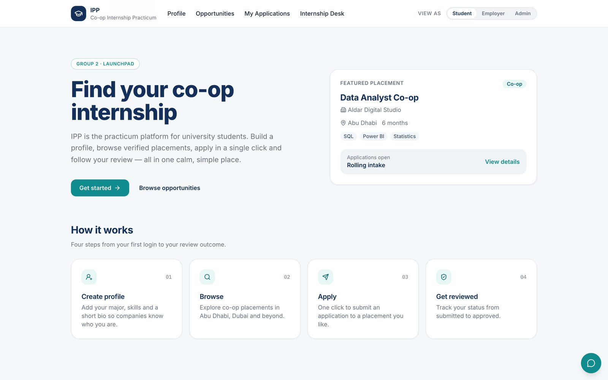
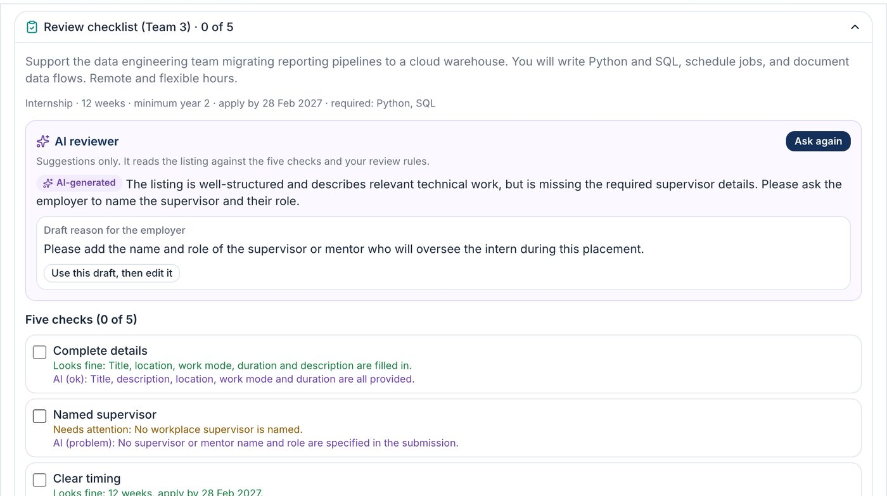
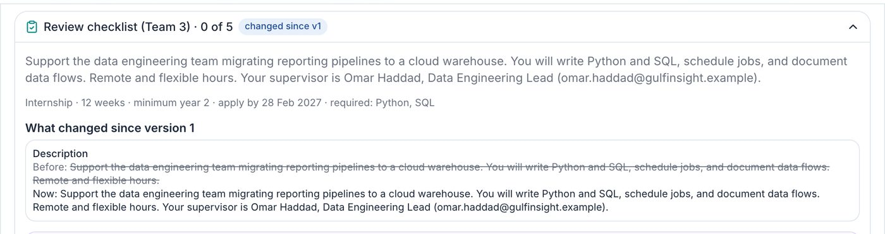
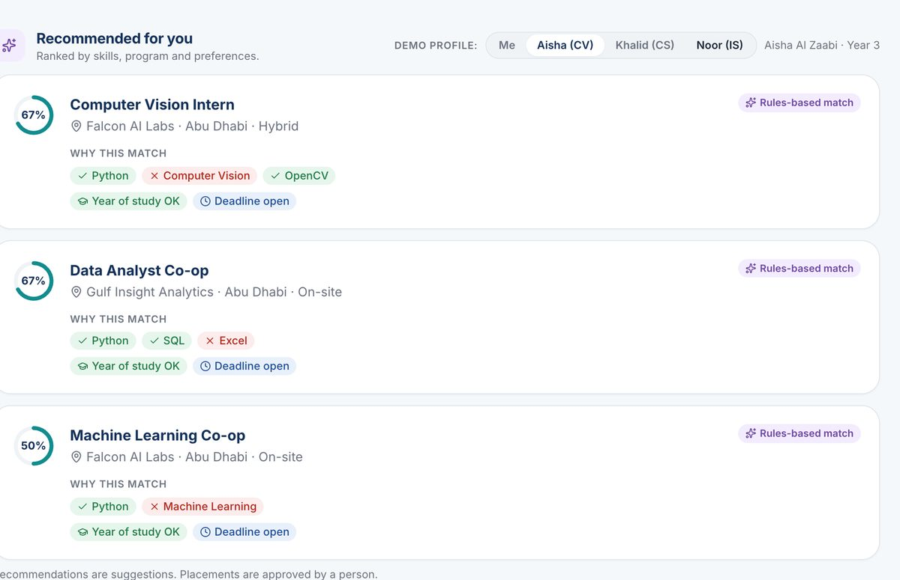
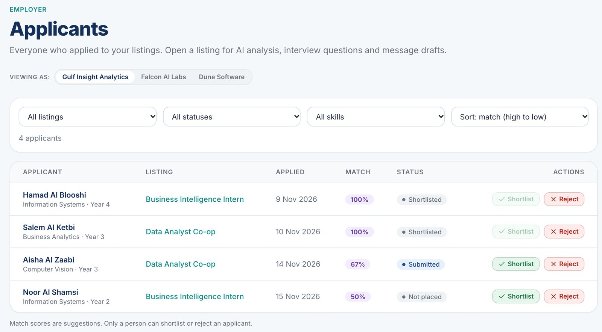
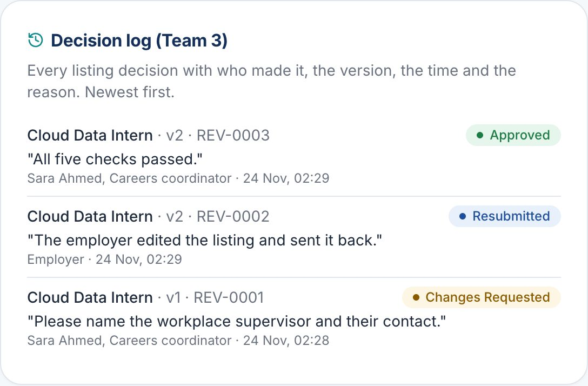
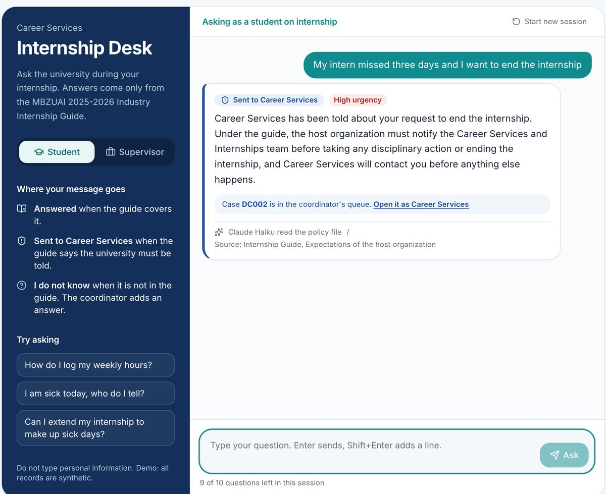

<div align="center">

# IPP: Internship Practicum Platform

**One shared app for all seven BUS 2010 Co-op teams.** Employers post internships, the university reviews and publishes them, students apply, and an AI desk supports everyone during the internship. AI suggests; a person decides.

[](https://github.com/ipp-coop-2026/ipp-coop/actions/workflows/ci.yml)
[](https://ipp-coop-preview.noel-clara.workers.dev)


[Live demo](https://ipp-coop-preview.noel-clara.workers.dev) · [Architecture](docs/ARCHITECTURE.md) · [Workflow](docs/WORKFLOW.md) · [Contributing](CONTRIBUTING.md) · [Integration guide](INTEGRATION.md)



</div>

> **Demo data only.** Every person, organisation and listing is synthetic. Role switching is simulated with "View as"; there is no real login.

## One listing, end to end

The common app uses **Group 2's Launchpad** (P02, Employer) as its interface, agreed by the teams on 23 Nov 2026. Every team's part sits in the view where it fits.

| Step | Who | What happens | Built by |
| --- | --- | --- | --- |
| 1 | Employer | Posts a listing, with Draft with AI, Improve wording and Suggest skills | Group 2 (P02) |
| 2 | Careers coordinator | Approves or rejects in one click, or opens the review checklist: five checks, an AI reviewer and "Request changes" | Group 2 (P02) · checklist by Team 3 (P03) |
| 3 | Employer | Sees the university's reason, fixes the listing and resubmits it as version 2 | Team 3 (P03) |
| 4 | Careers coordinator | Sees what changed since version 1, approves; the decision log records who, which version, when and why | Team 3 (P03) |
| 5 | Student | Gets recommendations with reasons, applies, follows the application | Group 2 (P02) · matching data by Team 5 (P05) |
| 6 | Employer | Reviews every applicant, with AI analysis, interview questions and message drafts | Group 2 (P02) |
| 7 | Student or supervisor | Asks the Internship Desk during the internship; real problems go to Career Services | Team 3 (P03) |

<table>
<tr>
<td width="50%"><br><sub>AI reviewer flags the missing supervisor and drafts a reason (Team 3)</sub></td>
<td width="50%"><br><sub>The employer's version 2, with what changed (Team 3)</sub></td>
</tr>
<tr>
<td><br><sub>Recommended for you, with reasons (Group 2)</sub></td>
<td><br><sub>Applicants tab: every applicant, filters and match scores (Group 2)</sub></td>
</tr>
<tr>
<td><br><sub>Decision log: requested, resubmitted, approved (Team 3)</sub></td>
<td><br><sub>Internship Desk sends a supervisor's problem to Career Services (Team 3)</sub></td>
</tr>
</table>

## AI features

| Feature | Where | Built by | Human in charge |
| --- | --- | --- | --- |
| Profile assistant | `/p01/profile` | Team 1 (P01) | Explains the profile and proposes changes to a draft; the student applies them, a coordinator reviews |
| IPP Assistant (FAQ chatbot) | Student, floating button | Group 2 (P02) | Answers only from the approved FAQ; "Talk to a human" hands off to the coordinator |
| Recommended for you | Student → Opportunities | Group 2 (P02) | Suggestions with reasons; placements are approved by a person |
| Draft with AI, Improve wording, Make shorter, Suggest skills | Employer → Post Opportunity | Group 2 (P02) | The employer edits and submits; the coordinator approves |
| AI analysis, interview questions, message drafts, AI assistant | Employer → Applicants | Group 2 (P02) | Only a person can shortlist or reject |
| AI Review Log | Admin | Group 2 (P02) | Every AI output is logged, with model or fallback |
| AI reviewer and five-check checklist | Admin → pending listings | Team 3 (P03) | The coordinator decides; the log records ticked checks and whether the AI draft was used |
| Internship Desk | Student, supervisor | Team 3 (P03) | Problems go to Career Services with urgency and a case number |

Every AI feature works without a model key (approved FAQ, rules or templates) and labels its answer "AI-generated" or "Rules-based" on screen. The model is Claude Haiku, called only from the server, with a daily cap.

## Quick start

```bash
npx -y bun@1.4.0 install --frozen-lockfile
npx -y bun@1.4.0 run dev        # http://localhost:8080
npx -y bun@1.4.0 x tsc --noEmit  # CI runs these three
npx -y bun@1.4.0 run test        # 212 tests
npx -y bun@1.4.0 run build
```

Optional server-side settings (never in git; use `.env.local` or the host's secret store). [`.env.example`](.env.example) lists them all.

| Variable | Turns on |
| --- | --- |
| `ANTHROPIC_API_KEY` | AI answers for Launchpad's AI features, the AI reviewer and the Internship Desk |
| `AI_DAILY_CAP` | Daily limit on model calls (default 150) |
| `DESK_REDIS_URL` | Desk cases shared across devices (otherwise kept in server memory) |
| `P03_TEAM_KEY` | Team 3's writes to the shared database, through a server route |

## Deploying

| Host | How | Notes |
| --- | --- | --- |
| Cloudflare Workers (live preview) | `bun run build`, then `npx wrangler deploy` | Secrets set with `wrangler secret put` |
| Cohesivity | `node deploy/cohesivity.mjs` | Needs a `.cohesivity` file (gitignored); see [INTEGRATION.md](INTEGRATION.md) |
| Render (Team 1) | [`render.yaml`](render.yaml) | `NITRO_PRESET=node-server bun run build`, then `node .output/server/index.mjs` |

## Project structure

```text
src/
  routes/              one file per page
    index, profile, opportunities.*, applications      student view (Group 2)
    employer.*                                         employer view (Group 2)
    admin.index, admin.ai-logs, admin.desk             admin view (Group 2, with Team 3's checklist and desk queue)
    desk, p03.*, p05.*                                 team modules (Team 3, Team 5)
    api/                                               server routes: p02.ai, ai-review, desk, p03.review, chat
  components/
    AppShell.tsx       header, "View as" switch, footer credits
    p02/               Launchpad components: assistant, listing form, skill picker
  lib/
    p02/               Launchpad data, store, matching and AI tasks (Group 2's design)
    p03/               review, AI reviewer, Internship Desk, shared-database writes (Team 3)
    p05/, db/          matching engine and read-only shared Supabase client (Team 5)
  test/                vitest suites
deploy/                Cohesivity entry and runtime shims
docs/                  architecture, workflow, requirements, decisions, test cases, port notes
sprint-1/, sprint-2/   sprint boards, briefs, Scrum of Scrums records
```

## Data

The demo keeps its records in each browser (`localStorage`), so two devices do not share changes yet; "Reset demo data" in the footer restores the seed. The class's shared Supabase database is hosted by Team 5: reads use the public key in [`src/lib/db`](src/lib/db), writes go through server routes with each team's own key. The mapping is in [INTEGRATION.md](INTEGRATION.md).

## Contributing

One repository, one app, one module per team ([architecture](docs/ARCHITECTURE.md)). Work on a `p0X/topic` branch and open a pull request into `main`. GitHub enforces the rules on `main`: pull request only, one approving review, passing CI (type-check, tests, build), no force-push. [CODEOWNERS](.github/CODEOWNERS) routes each module to its team. Read [CONTRIBUTING.md](CONTRIBUTING.md) first; never commit keys or real personal data ([SECURITY.md](SECURITY.md)).

## Documents

| File | Contents |
| --- | --- |
| [docs/ARCHITECTURE.md](docs/ARCHITECTURE.md) | One app with a module per team, folder ownership, module rules |
| [docs/WORKFLOW.md](docs/WORKFLOW.md) | Roles, branches, rules on `main`, releases, plan to the final presentation |
| [INTEGRATION.md](INTEGRATION.md) | Team ownership, code map, shared-database mapping, deploy, merge order |
| [docs/port/launchpad-v2-survey.md](docs/port/launchpad-v2-survey.md) | How Group 2's Launchpad was surveyed and rebuilt, page by page |
| [docs/requirements.md](docs/requirements.md) | Product goals, shortlist, traceability |
| [docs/data-dictionary.md](docs/data-dictionary.md) | Records, IDs, statuses, seed data |
| [docs/decisions.md](docs/decisions.md) | Decision log |
| [docs/test-cases.md](docs/test-cases.md) | Acceptance tests and results |
| [sprint-2/crisp-dm-mapping.md](sprint-2/crisp-dm-mapping.md) | CRISP-DM mapping for the AI features |

## Credits

Built by the BUS 2010 (Fall 2026) class teams at MBZUAI.

| Team | Contribution |
| --- | --- |
| **Group 2 (P02, Employer)** | **Launchpad**, the interface and base of this app: the student, employer and admin views and their AI features (assistant, recommendations, employer AI tools, AI review log). Original prototype: launch-path-ipp.base44.app |
| **Team 3 (P03, University review and publication)** | **The shared platform**: GitHub organisation and this repository, CI, protected `main`, CODEOWNERS and team access, architecture and workflow docs; **Launchpad rebuilt in code** from Group 2's live prototype (Base44 cannot export code); the live preview with server-side AI and a daily cap; Group 2's requested changes (Applicants tab, dashboard links, P02 credit). **P03 module**: review checklist, AI reviewer, request changes and versioned resubmits, decision log, Internship Desk, shared-database review queue |
| **Team 5 (P05)** | Shared Supabase database, read-only client, matching engine, match coordinator page, and the first unified look for the Sprint 3 request (five merged pull requests) |
| **Team 1 (P01)** | The first common app, student profiles and the FAQ chatbot |

### Contributors

| GitHub | Team | Work in this repository |
| --- | --- | --- |
| [@11NOel11](https://github.com/11NOel11) | Team 3 (P03) | Maintainer and merge lead: repository, CI and rules, Launchpad rebuild, P03 module, live preview |
| [@TheCYPER](https://github.com/TheCYPER) | Team 5 (P05) | Unified look (#2), shared-database client (#4), matching engine and recommendations (#6), match coordinator page (#7) |
| [@GravityCodez](https://github.com/GravityCodez) | Team 1 (P01) | The Team 1 app snapshot this repository started from |
| Group 2 (P02) | Employer | Designed and built the Launchpad prototype on Base44 that this app's interface follows |

Thanks also to every team's Scrum of Scrums liaison for the cross-team decisions recorded in [docs/decisions.md](docs/decisions.md). Policy answers in the Internship Desk come from the MBZUAI 2025–2026 Industry Internship Guide.
